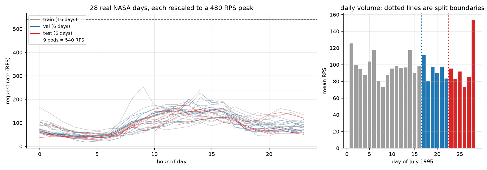
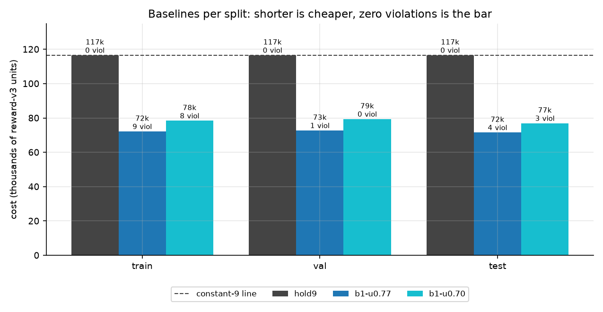
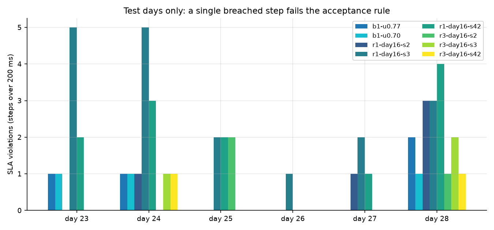
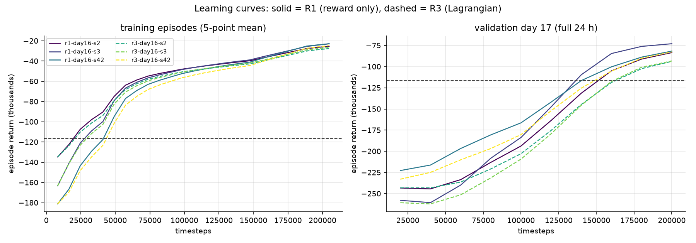
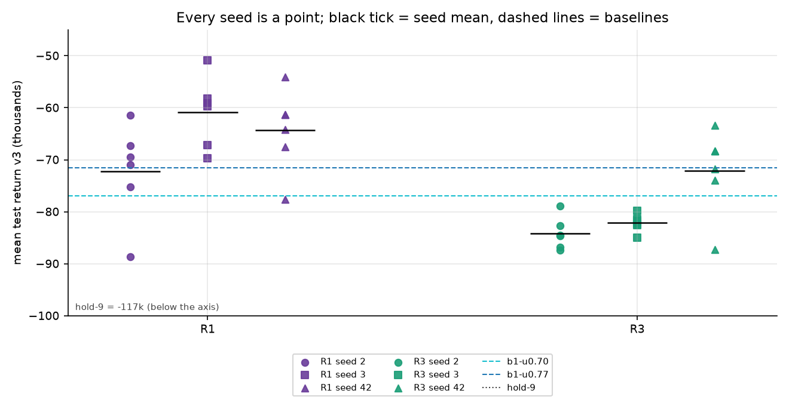
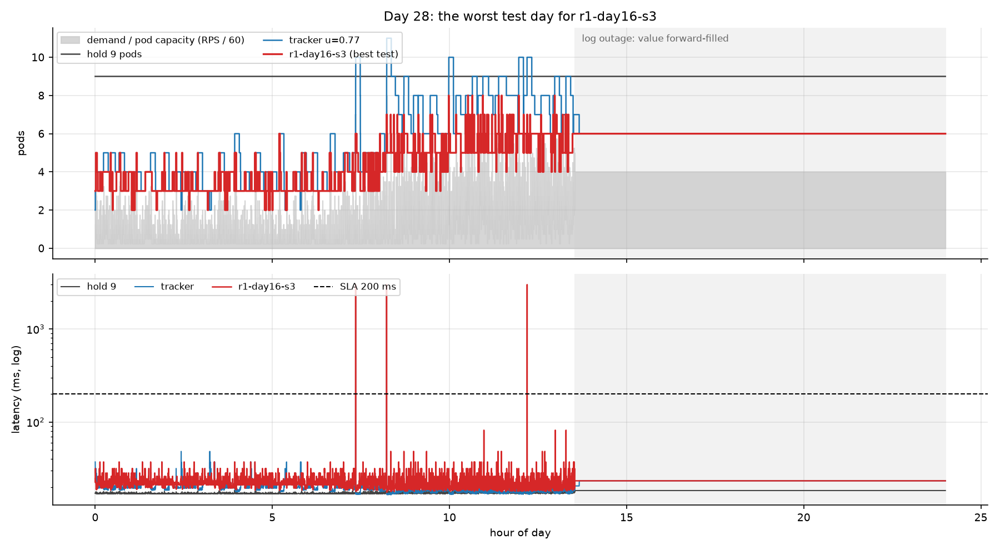
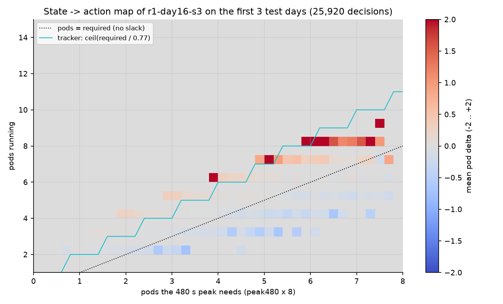
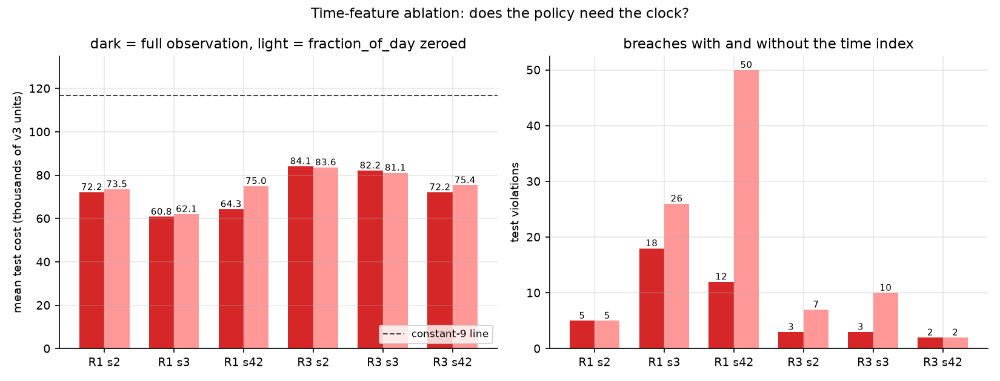
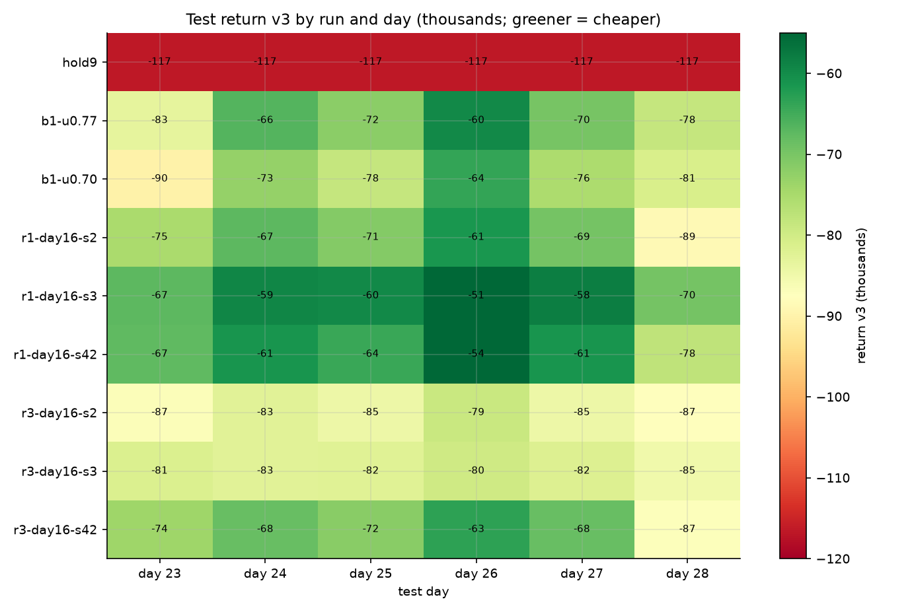
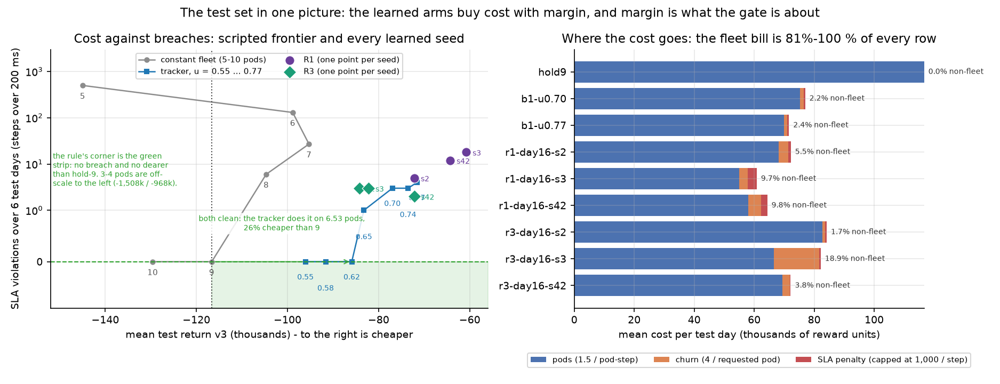

# The 16/6/6 experiment, in full

*A learned autoscaler trained on 16 days of real traffic, scored on 6 it has never
seen: what it cost, what it broke, and why those two facts are the same fact.*

This is the long-form companion to [`results/summary.md`](../results/summary.md)
(the tables), [`docs/DESIGN.md`](DESIGN.md) §12 (the design and the argument) and
[`plots/`](../plots) (the ten figures). Every number here comes from a file in
`results/` or from a figure; nothing is estimated. The reproduction commands are
in §13.

---

## 0. Five findings, in order of how much they should change your mind

1. **The cost claim survives out of sample, and it is not close.** All six learned
   checkpoints beat the 9-pod hold on six unseen days, by 28 % to 48 %. The mean
   R1 seed costs −65,791 per day against hold-9's −116,640.
2. **The safety claim fails for every arm, including the heuristic baseline.**
   Every learned seed breaches, and so do both trackers used as baselines
   (3 and 4 breached steps). The acceptance rule fixed before the run —
   *zero* steps over 200 ms *and* cheaper than hold-9 — is met by nothing that is
   cheaper than hold-9.
3. **A clean policy does exist, and it is cheap: −85,898 (26 % below hold-9).**
   The trailing-max tracker at `u=0.62` runs 6.53 pods on average and never
   breaches in six days. The learned arms' failing is therefore not "clean is
   unaffordable" — clean costs *less* than the hold. It is that the learned
   policies sit at the wrong point on the frontier (§4, §5).
4. **The rewards explain the fleet *size*, not the last pod.** v3 caps a breached
   step at 1,000 units and one spare pod-day costs 12,960, so a *standing* extra pod
   has to prevent **13** breach steps a day before it pays — and near the safe end
   the marginal price of a breach is 11,900–18,800 units, i.e. 12–19× the cap. Every
   arm therefore correctly keeps a small fleet; that is the 28–48 % saving (§6). But
   the same pod, applied only on the ~1 % of steps where demand jumps a full pod,
   costs ≈200 units a day and removes all 43 breaches (§7, §12). The arms are right
   about *how many* pods and wrong about *when*.

5. **Every breach is a single 10 s step at or one pod under `ceil(rps/60)`** — the
   exact M/M/k saturation boundary. 40 of the 43 stall at the 3,000 ms clamp; the
   other three are 207–665 ms, i.e. one pod *just* short rather than two. The
   policies run the fleet at 100 % utilisation at the traffic peaks, where latency
   is infinite by definition. The gap to clean is therefore *margin*, not
   anticipation, spend or stability (§7).

If you only read one section, read §7: it is the part of this result that is not a
table lookup.

---

## 1. How to read the numbers

| term | meaning |
|---|---|
| **step** | 10 s of simulated time; a day is 8,640 steps |
| **return v3** | the reward v3 score of a whole replay, summed over steps. It is a **negative cost**, so *less negative is cheaper* |
| **violation / breach** | one step with latency strictly above 200 ms. A gate, not a cost: one step fails the run |
| **clean** | zero violations on the days in question |
| **accepted** | clean **and** mean return v3 strictly above the constant-9 line (−116,640) |
| **pod-step** | one pod for one step, 1.5 reward units |
| **pod-day** | one pod for 8,640 steps, 12,960 reward units |

Two of these interact in a way that decides the whole experiment: **a breach is
capped at 1,000 units, a pod-day costs 12,960.** Everything in §7 follows from
that ratio.

The price v3 pays per step is

```
step reward = -(1.5 * pods)                       # fleet
              -(4.0 * |requested delta|)          # churn, charged on the request
              - min(1,000, 4.0 * max(0, latency - 150))
```

so the latency term ramps at 4 units per ms from 150 ms, reaches 200 units at the
200 ms SLA, hits its 1,000-unit cap at **400 ms**, and is flat from there to the
3,000 ms overload clamp. A 410 ms blip and a 3,000 ms stall cost exactly the same.
That flatness is not a detail — it is why the arms have no gradient toward
"less deep" failures once they are over the line (§7).

Flat in **depth**, not in **count**. The term is charged on every step, so *N*
breach steps at the clamp cost *N* × 1,000 — the scored runs show it exactly:
`return_v3 = -(cost + churn) - 1,000 × violations` holds for all nine learned
rows (`r1-s3`: 3 breaches, 3,000 units of penalty; `r3-s2`: 1 breach, 1,000). One
millisecond deeper is free past 400 ms; one more breached step never is.

Because the fleet term is linear in pods and paid every step, **the fleet bill is
81–100 % of every row's cost** (figure 10, right panel). The reward is, almost
entirely, a pod-count meter with a cheap penalty bolted on.

---

## 2. What was measured, on what

**The traffic.** 28 days of the NASA Kennedy Space Center HTTP log (July 1995),
binned into 8,640 ten-second slots per day and rescaled so each day peaks at
480 RPS. The log's flat stretches (collector outages, forward-filled by the
generator) are kept: day 28 has 10.5 h of them. Dropping a day *after* seeing its
score would be picking the test set, and a flat tail is easy traffic, so it makes
that day cheaper, not harder.

**The physical model.** `env/cloud_env.py` is a simplified M/M/k queue: one pod
serves 60 RPS, so a fleet's capacity is `60 x pods`. Latency is

```
latency = 1,000 / (60*pods - rps) + 15 ms   if 60*pods > rps
        = 3,000 ms                          otherwise
```

Three consequences matter everywhere below:

* Latency hits the 200 ms SLA at **91 % utilisation**. The cliff does not start at
  100 %; it starts when the fleet is ~9 % short of the instantaneous demand.
* `pods = ceil(rps / 60)` means capacity exactly equals demand, so the model
  returns the 3,000 ms clamp. Because every day is rescaled to peak at exactly
  480 RPS, the daily peaks land *exactly* on the pod grid: `ceil(480/60) = 8` is
  exactly 480 RPS of capacity, i.e. a clamp. **"Just enough" pods is a breach
  precisely at the peaks** — anywhere else, `ceil` leaves 5–60 RPS of spare
  capacity and the latency is fine.
* At the rescaled peak of 480 RPS, holding the SLA needs `(480 + 5.4)/60 = 8.09`
  pods, i.e. **9**. That is why hold-9 is the clean constant, and why hold-8
  breaches exactly once per day — at the peak (§4).

**The split.** Chronological, never shuffled: days 1–16 train, 17–22 validate,
23–28 test. Checkpoint selection uses day 17 only; the test set was scored once,
after the acceptance rule was written down.

**The arms.**

| family | what it is | runs |
|---|---|---|
| R1 | PPO, reward v3, 200k steps | 3 seeds (2, 3, 42) + 3 time-ablated scorings |
| R3 | PPO, reward v3 **plus** a Lagrangian price on breach steps (λ = 1,000) | same 3 seeds + ablations |
| b1 | scripted trailing-max tracker: `ceil(max(rps over 480 s) / (u*60))` | 9 values of `u` (0.55 … 0.77) in `results/frontier.txt` |
| hold-p | constant fleet | 3–10 pods |

All of them are replayed through the same actuator (**±2 pods/step**, clipped to
[1, 15]) and priced by the same function, so a pod-minute costs the same for a
policy and for a baseline. That is what makes the tables below comparable at all.


---

## 3. What "clean" costs: the scripted frontier

`results/scores.csv` contains two trackers (u=0.70, u=0.77) and one hold, which is
not enough to answer the obvious question: *is there a clean policy cheaper than
hold-9, and how far from it are the learned arms?* `utils/frontier.py` answers it
by replaying the two scripted families over the six test days through the same
actor and the same price: `results/frontier.txt`.

| policy | pods | breaches (6 d) | days hit | mean return v3 | vs hold-9 |
|---|---|---|---|---|---|
| hold-3 | 3.00 | 8,889 | 6 | −1,508,249 | 13× dearer |
| hold-4 | 4.00 | 5,478 | 6 | −968,106 | 8.3× dearer |
| hold-5 | 5.00 | 499 | 6 | −144,981 | −28,341 |
| hold-6 | 6.00 | 130 | 6 | −98,858 | **+17,782** |
| hold-7 | 7.00 | 27 | 6 | **−95,284** | **+21,356** |
| hold-8 | 8.00 | 6 | 6 | −104,680 | +11,960 |
| **hold-9** | 9.00 | **0** | 0 | −116,640 | 0 (the line) |
| hold-10 | 10.00 | 0 | 0 | −129,600 | −12,960 |
| b1-u0.55 | 7.30 | 0 | 0 | −96,061 | +20,579 |
| b1-u0.58 | 6.96 | 0 | 0 | −91,630 | +25,010 |
| b1-u0.60 | 6.72 | 0 | 0 | −88,362 | +28,278 |
| **b1-u0.62** | **6.53** | **0** | 0 | **−85,898** | **+30,742 (−26 %)** |
| b1-u0.64 | 6.37 | 1 | 1 | −83,914 | +32,726 |
| b1-u0.65 | 6.31 | 1 | 1 | −83,230 | +33,410 |
| b1-u0.70 | 5.81 | 3 | 3 | −76,975 | +39,665 |
| b1-u0.74 | 5.55 | 3 | 3 | −73,533 | +43,107 |
| b1-u0.77 | 5.39 | 4 | 3 | −71,583 | +45,057 |

Four things to take from it.

**The constant fleet is the wrong shape, and the ladder says so.** Above 7 pods
the curve turns *up*: each extra pod costs 12,960 a day, and the cheapest rung of
all (hold-7, −95,284) still breaches 27 times, i.e. 4.5 times a day. Buying those
4.5 daily breaches (hold-7 → hold-9) costs 21,356 a day, which is **4,746 per
breach avoided — 4.7× what the reward charges for one**. Meanwhile a tracker with
the same *average* fleet (u=0.62 runs 6.53 pods, between hold-6 and hold-7) is clean.
The difference is not spend. It is *when* the pods are there: a constant fleet is
mostly wrong at both ends of the day, and the tracker is right at the peaks, which
is the only place the SLA is ever at risk. Figure 02 shows the ladder, figure 10
shows the same data as a frontier.

**Clean costs 26 % less than the hold.** u=0.62 achieves zero breaches at −85,898
with 6.53 average pods. So the honest framing of the whole experiment is not
"learning buys cost at the price of safety" but "learning lands 6,000 (R3) to
20,000 (R1) units *below* the cheapest clean scripted policy, and the missing
1–2 pods are exactly what buys the safety."

**The safety/price knife-edge is between u=0.62 and u=0.64.** One step of `u`
costs 1,984 a day, and it is the difference between 0 and 1 breach. Above that,
every further 0.02–0.05 of `u` buys at most one breach and sometimes none
(u 0.74→0.70 costs 3,442 a day and removes none). This non-monotonicity is why the
frontier is a *scatter with a knee*, not a curve, and why the tracker's parameters
were swept rather than guessed (figure 02, figure 10).

**Both trackers used as scoring baselines are on the wrong side of the knee.**
u=0.77 (4 breaches) and u=0.70 (3 breaches) are the rows in `results/scores.csv`.
They were chosen in DESIGN §11 as the *aggressive* trackers to beat on cost; they
are not the clean ones. Nothing in the decision rule changes — the rule demands zero
breaches of every arm — but a reader comparing "RL vs the baseline" should compare
against u=0.62 (clean, −85,898), not u=0.77 (breaching, −71,583). Against the first,
the learned arms are 1,700 (R3 seed 2) to 25,100 (R1 seed 3) cheaper; against the
second only R1 is cheaper (by 5,800–10,800) while R3 is 600–12,600 dearer. Safety is
lost either way.

---

## 4. The learned arms on the six unseen days

One row per checkpoint. All six were trained on days 1–16 for 200k steps, selected
on day 17, then scored once here.

| run | reward | seed | breaches | days hit | mean return v3 | vs hold-9 | avg pods |
|---|---|---|---|---|---|---|---|
| r1-day16-s3 | v3 | 3 | **18** | 6 | **−60,830** | −48 % | 4.24 |
| r1-day16-s42 | v3 | 42 | 12 | 5 | −64,344 | −45 % | 4.48 |
| r1-day16-s2 | v3 | 2 | 5 | 3 | −72,199 | −38 % | 5.26 |
| r3-day16-s42 | v3 + λ | 42 | **2** | 2 | −72,152 | −38 % | 5.35 |
| r3-day16-s3 | v3 + λ | 3 | 3 | 2 | −82,155 | −30 % | 5.14 |
| r3-day16-s2 | v3 + λ | 2 | 3 | 2 | −84,149 | −28 % | 6.38 |
| *mean R1* | | | *11.7* | | *−65,791* | *−44 %* | *4.66* |
| *mean R3* | | | *2.7* | | *−79,485* | *−32 %* | *5.62* |
| *hold-9* | | | *0* | | *−116,640* | *0* | *9.00* |
| *b1-u0.62 (clean)* | | | *0* | | *−85,898* | *−26 %* | *6.53* |

**Both reward designs do what they were asked to do, and they do it in opposite
directions.** R1 minimises v3 and lands cheapest (−65,791) with 11.7 breaches;
R3 pays a λ = 1,000 Lagrangian price per breach step on top of v3 and lands
13,694 dearer with 2.7 breaches. The Lagrangian moved the arm along the frontier in
exactly the expected direction — it just did not go far enough to reach zero, and
the distance left (2.7 breaches) is the same order as the seed noise.

**Seed spread is the same size as the differences being argued about.** R1's
standard deviation across three seeds is 5,821 and R3's is 6,429. The R1–R3 gap is
13,694 — only about 2 standard deviations, on three seeds. Two honest conclusions
follow: (i) R1 and R3 are *different* points on the frontier, not noise; (ii) any
claim of the form "seed 3 is the best configuration" is not supported — seed 3 is
the cheapest R1 *and* one of the two breachiest runs. Figure 05 is the seed
spread, figure 09 the run × day matrix.

**The best operating point is R3 seed 42**: −72,152 (38 % cheaper than hold-9) with
2 breaches in six days. Compare it with the clean tracker at −85,898, 13,746
*more* expensive: R3 is buying its 13,746 of extra savings by running 5.35 pods
instead of 6.53. That is 1.18 pods — one per day at the peak — and it is the whole
of the difference between "2 breaches" and "0 breaches".

---

## 5. The rule, applied

The rule was fixed before the run and is the one in `utils/score_policy.py`:

> a rung is **accepted** iff every seed is violation-free on every test day **and**
> its mean test return v3 is strictly above the constant-9 line (−116,640).

| arm | breaches | zero breaches? | cheaper than −116,640? | accepted |
|---|---|---|---|---|
| R1 (reward only) | 35 | no | yes (−65,791) | **no** |
| R3 (Lagrangian) | 8 | no | yes (−79,485) | **no** |
| b1-u0.77 | 4 | no | yes (−71,583) | **no** |
| b1-u0.70 | 3 | no | yes (−76,975) | **no** |
| hold-9 | 0 | yes | — (it *is* the line) | — |

**Nothing is accepted.** The result of the experiment is therefore two-part, and
the second part is the interesting one:

* the **cost** claim generalises: 6/6 checkpoints, 6/6 unseen days, 28–48 % below
  the hold;
* the **safety** claim does not: 6/6 checkpoints breach, and so does every cheap
  scripted policy tried.

A weaker rule ("no more than 3 breaches") would accept R3 seed 42. A rule that
demanded "cheaper *and* clean" would have been satisfiable only by a tracker — or by
a learned arm wrapped in the one-pod guard of §12, which is not the policy as
trained. On this task the achievable frontier has clean points, they are cheap, and
PPO did not find them at 200k steps.

---

## 6. Why: the economics of a breach step

This is the section that turns the tables into an explanation. It has three
numbers in it, and they are all already on the page.

**1. A breach costs at most 1,000. A pod-day costs 12,960.**

```
cap on one breached step          1,000 units
one pod for one day               1.5 x 8,640 = 12,960 units
breaches a spare pod-day must prevent   12,960 / 1,000 = 13
```

So a reward-maximising agent is *indifferent* between thirteen breach steps a day
and one extra pod. Below thirteen, buying the pod is strictly worse than wearing
the breaches. R1 runs at ~6 breaches a day (35 over 6 days) and is 44 % cheaper
than the hold: that is not a policy that failed to understand the task, it is the
argmax of the reward it was given. DESIGN §7 says the same thing from the other
side: a hard SLO is a constraint, and a penalty is a price; you get what you price.

**2. At the safe end, the market price of a breach is 12–19× the cap.**

The cap sets the *average* trade. The marginal trade at zero breaches is much
worse, because the last few breaches are the rare ones at the sharpest peaks:

| move | Δ cost / day | breaches removed (6 d) | price per breach |
|---|---|---|---|
| hold-6 → hold-7 | 3,574 | 103 | 208 |
| hold-7 → hold-8 | 9,396 | 21 | 2,685 |
| hold-8 → hold-9 | 11,960 | 6 | **11,960** |
| b1 u=0.64 → 0.62 | 1,984 | 1 | **11,904** |
| b1 u=0.70 → 0.65 | 6,255 | 2 | **18,765** |
| b1 u=0.74 → 0.70 | 3,442 | 0 | — (pure waste) |
| b1 u=0.62 → 0.55 | 10,163 | 0 | — (pure insurance) |

Going from 27 breaches to 6 (hold-7 → hold-8) already costs 2,685 each — 2.7× the
cap — and the last six cost 11,960 each. **No *static* move on this frontier is
worth making for a v3 maximiser**, which is why every learned arm sits at the cheap,
breaching end, and why the two trackers in `results/scores.csv` (u=0.70, 0.77) were
chosen there too: they were the aggressive rows, and they are the ones that breach.
The qualifier matters: a move that is *conditional* — one pod, only on the steps
where demand jumps — is not priced by this table at all, and §7/§12 show it is the
cheap one.

**3. The penalty is flat from 400 ms to 3,000 ms, so there is no gradient to
"shallower".** §1's formula caps at 1,000 units from 400 ms up. A policy that is
one pod short at a peak is *exactly* as expensive as a policy that collapses for a
minute — the reward cannot tell them apart. Everything about breach *depth* that
the reader cares about is invisible to the training signal; only the binary "any
step over 200 ms" survives, and even that shows up as a bounded price.

**What the Lagrangian buys, and what it cannot.** R3 charges λ = 1,000 per breach
step *outside* the reward (a dual variable, frozen after 1,000 updates). That is
the same magnitude as the cap, but it is applied per step on top of it, so it
doubles the effective price of a breach and, crucially, it is not itself capped by
the reward's construction. The result: 8 breaches instead of 35, at a cost of
13,694 a day. The arm moved along the frontier by the amount the price was raised
— to reach zero it would have needed roughly the price that §3's table says clean
costs, i.e. λ closer to the 12,000–19,000 marginal rate, or a longer run.

**The one-line version.** *v3 prices a breach at 1,000 and a pod-day at 12,960.
Every learned arm is cheaper than hold-9 because it is buying the 12,960 and
selling the 1,000. The acceptance rule asks for zero breaches; the reward never
did.*

---

## 7. Anatomy of the 43 breaches

`results/scores.csv` gives a count per day. To say what a breach *is*,
`utils/breach_profile.py` replays each checkpoint and, for every step over 200 ms,
prints the burst it belongs to, the traffic, the fleet the policy ran, the fleet
the M/M/k arithmetic needed (`ceil(rps/60)`) and the latency:

```bash
python utils/breach_profile.py models/sla/r1-day16-s3.zip models/sla/r3-day16-s42.zip
```

Across the six `day16` checkpoints on the six test days there are **43 breached
steps, in 43 bursts**. Not one pair of consecutive steps.

| seed | breaches | consecutive? | short by 0 pods | short by 1 pod | at 3,000 ms |
|---|---|---|---|---|---|
| R1 seed 2 | 5 | never | 5 (100 %) | 0 | 5 (100 %) |
| R1 seed 3 | 18 | never | 8 (44 %) | 10 (56 %) | 17 (94 %) |
| R1 seed 42 | 12 | never | 6 (50 %) | 6 (50 %) | 11 (92 %) |
| R3 seed 2 | 3 | never | 3 (100 %) | 0 | 2 (67 %) |
| R3 seed 3 | 3 | never | 3 (100 %) | 0 | 3 (100 %) |
| R3 seed 42 | 2 | never | 2 (100 %) | 0 | 2 (100 %) |
| **total** | **43** | **never** | **27 (63 %)** | **16 (37 %)** | **40 (93 %)** |

Four facts, each of which rules out a different story about what went wrong.

**Fact 1 — the policy is not unstable; it is exactly at capacity.** In 27 of 43
breaches the policy was running *precisely* `ceil(rps/60)` pods: capacity equal to
instantaneous demand, where the queueing model returns its 3,000 ms clamp by
definition. In the other 16 it was one pod below. There is no case of running
2+ pods short, no oscillation, no overshoot-then-collapse. The controller has
converged on the boundary of feasibility and stays there.

**Fact 2 — every breach is a single step.** The environment caps a move at ±2 pods
and the traffic spike lasts one sample, so the same trajectory is back inside the
SLA at the next step. Total exposure across all six arms and all six days is
43 x 10 s = 7 minutes; per arm-day it ranges from 3 s (R3 seed 42) to 30 s
(R1 seed 3). Nothing here looks like a controller losing the plant.

**Fact 3 — the breaches cluster on a handful of traffic instants.** Eight steps out
of 51,840 carry 27 of the 43 breaches (63 %), and every one of them is a step
where demand jumped by a full pod between samples:

| when | rps | pods needed | arms that breached there |
|---|---|---|---|
| day 24, 14:19 | 480.0 | 8 | R1 s3, R1 s42, R3 s3 |
| day 24, 19:04 | 360.0 | 6 | R1 s2, R1 s3, R1 s42, R3 s42 |
| day 25, 11:38 | 418.5 | 7 | R1 s3, R3 s2 |
| day 25, 12:47 | 480.0 | 8 | R1 s3, R3 s2 |
| day 27, 15:46 | 480.0 | 8 | R1 s2, R1 s3, R1 s42 |
| day 28, 07:21 | 420.0 | 7 | R1 s2, R1 s3, R1 s42, R3 s3 |
| day 28, 08:13 | 480.0 | 8 | **all six** |
| day 28, 12:11 | 420.0 | 7 | R1 s2, R1 s3, R1 s42 |

The 480 RPS rows are the rescaled daily peak; the 420 RPS rows are the shoulder
where a 6-pod fleet stops being enough. At the peak, all six arms independently
converged on **8 pods** — exactly 480 RPS of capacity, the largest fleet that
breaches there — because the ninth pod costs 12,960 a day and the reward prefers
the bill.

**Fact 4 — three of the 43 are barely over the line, and the reward does not care.**
The latencies at breach are 3,000 ms in 40 cases; the exceptions are 206.7 ms
(R1 s3, day 26), 665 ms (R1 s42, day 25) and 665 ms (R3 s2, day 25). Under v3 each
of those three costs the same 1,000 units as a full stall (the cap binds from
400 ms), and under the acceptance rule they are equally fatal. This is §6's
flatness seen from the other end: a policy that shaves a 3,000 ms failure down to
210 ms earns *nothing* for it.

**The uncomfortable corollary.** One extra pod at any of the 43 instants would have
covered the breach — the shortfall column is never more than 1. So the learned arms
are not missing a control capability, a model class or a training signal shape.
They are missing **one pod of margin at the peaks**, which is exactly what
`u = 0.62` buys the tracker (13 pods at the peak instead of 8) and exactly what the
reward prices at 12,960 a day against 1,000 a breach.

**But the margin they are missing is *conditional*, and that changes the price.**
Averaged over the whole day the arms are not thin at all: measured against
*instantaneous* demand (`ceil(rps/60)`) they carry +2.2 (R1 seed 3) to +4.3
(R3 seed 2) pods of slack, and satisfy `pods ≥ ceil(rps/60) + 1` on 98.5–100 % of
steps. The failure is confined to the ~1 % of steps where demand jumps a full pod
between samples, and there the fleet is at exactly `ceil(rps/60)`.

That is why the fix in §12 is a *guard*, not a bigger fleet: a standing extra pod
costs 12,960 a day (§6), while the same pod, applied only where it is needed, is
the cheapest thing in this document.

---

## 8. Does the policy need the clock?

The last doubt about the cost result is memorisation: 16 days is enough to learn
"scale up at 09:00", which would be worthless on a new month. The test is
mechanical — score the same checkpoints with the `fraction_of_day` feature zeroed
(`--ablate time`), so the policy cannot know where in the day it is:

| rung | breaches, full | breaches, no clock | return v3, full | return v3, no clock |
|---|---|---|---|---|
| R1 | 11.7 | **27.0** (2.3×) | −65,791 | −70,193 (6.7 % costlier) |
| R3 | 2.7 | **6.3** (2.4×) | −79,485 | −80,026 (0.7 % costlier) |

Read it twice, because the two halves point in opposite directions:

* **The cost advantage does not depend on the clock.** With the hour removed, R1 is
  still 40 % cheaper than hold-9 and R3 still 31 %. Whatever the policies learned
  about *how many* pods a given load needs, they learned it from demand, not from
  the time.
* **The safety does.** Breaches more than double in both rungs, and the extra ones
  are spread across the week rather than concentrated on one day: even day 26, the
  calmest day, goes from 1 breach to 9 across the six ablated scorings. Without
  the hour the policy can no longer start climbing *before* the morning ramp, so it
  arrives late at every peak. The time feature is therefore a **safety crutch** —
  the one component that will not transfer to a different month with a different
  schedule — and the cheapest one to break on purpose, since removing it costs
  almost nothing on spend.
* **One seed does not need it.** `r3-day16-s42` scores 2 breaches with and without
  the clock. The average is a 2.4× effect, but it is not a law: a policy that
  tracks the trailing peak well enough does not have to know the hour. That is also
  the seed whose *full* model is closest to the clean tracker on cost, which fits.

Figure 08 is this table as a picture: paired bars per seed, and a second panel
plotting breaches with and without the clock.

---

## 9. Day by day

Breaches summed across the six learned arms:

| test day | mean rps | p95 rps | breaches | what is on that day |
|---|---|---|---|---|
| 23 (Sun) | 95.6 | 220 | 7 | includes the replay's first step, a cold start |
| 24 (Mon) | 83.2 | 218 | 11 | a 480 RPS peak at 14:19; the 360 RPS step at 19:04 |
| 25 (Tue) | 91.8 | 234 | 6 | a 480 RPS peak at 12:47 |
| 26 (Wed) | 73.1 | 188 | **1** | calmest day; one 206.7 ms near-miss |
| 27 (Thu) | 85.3 | 211 | 4 | a 480 RPS peak at 15:46 |
| 28 (Fri) | 153.7 | 240 | **14** | busiest day; 10.5 h of forward-filled flat tail |

Two readings.

**Day 28 collects 14 of the 43 breaches (33 %).** It is by far the busiest of the
six (153.7 mean RPS against 73.1 on day 26) and it is the day with the flat tail. It
is also the day every arm breaches on between 1 and 4 times, which is why it is the
day plotted in figure 06 and flagged in `results/inventory.csv`. The breaches on
day 28 are at 07:21, 08:13 and 12:11 — before the log stops around 13:20 — so they
are not an artefact of the forward-fill; the flat tail only makes the *average*
cost of that day look good.

**Volume alone does not explain the rest.** Day 24 has the *second lowest* mean
(83.2) and the most breaches after day 28 (11), while day 23 (95.6) has 7. What
predicts breaches is not the day's average but whether it contains a step at the
480 RPS peak or a 420 RPS shoulder — which is the same conclusion §7 reached from
the other direction. The day-level table is the macro version of the step-level
table.

**Day 26, the calmest day, produced one breach, and it was a 206.7 ms one.** So
the arms are not uniformly bad: on easy traffic the same policies are compliant,
and the acceptance rule fails on six days because of a handful of peak steps. This
is worth stating plainly because it is the strongest argument for the "margin at
the transient" reading: the policies are safe everywhere except at the top of the
ramp, which is where the reward says a pod is not worth 12,960.

Figure 03 shows the per-day breach counts per arm; figure 09 is the full
run x day cost matrix.

---

## 10. The ten figures, and what to look for in each

All ten are regenerated by `python utils/make_plots.py` from `results/*.csv` and
the checkpoints; none of them recompute a metric differently from the tables.

### 01 — the split


Left: all 28 days as hourly means, coloured by split, with the 9-pod line
(540 RPS) drawn in. The daily shape is the same everywhere — a noon plateau, a
quiet evening — which is why a policy can generalise at all. Right: each day's
mean volume; the dotted verticals are the 16/6/6 boundaries. Look for how little
the *shape* varies and how much the *level* does: the split is chronological, so
the model has never seen day 28's volume, though it has seen its shape.

### 02 — the baselines


Cost (positive = worse) for hold-9 and the two trackers on each split, with the
violation count written above each bar. Two things to read: the trackers are
37,000–45,000 cheaper than the hold on every split, and the cleanest bar in the
figure is the tracker on **val** (0 breaches for u=0.70, 1 for u=0.77). That val
row is the single-day control that made the earlier sections look optimistic, and
it is why §12 of DESIGN exists.

### 03 — which test days breach


Breached steps per test day, per arm — the two trackers lead each cluster (dark
blue `b1-u0.77`, cyan `b1-u0.70`), then the six learned runs. The learned arms
cluster on 23, 24 and 28; day 26 has a single breach (R1 seed 3) and day 25 six.
This is the figure to look at before believing any "0 violations on average" claim:
the distribution is spiky, and the two trackers are in the same spiky company.

### 04 — learning curves


Left: training-episode reward (4 h windows, 5-point mean) against timesteps, solid
= R1, dashed = R3, with the hold-9 line at −116,640. Right: the same checkpoints
evaluated on the full validation day 17 — a *whole day*, so the magnitudes are not
comparable with the left panel; what matters is the order. Read three things: every
curve crosses the hold line and ends a clear margin above it (the cost claim is
visible before any test day is scored); the R1 seeds separate visibly on val
(`r1-day16-s3` is the top solid line, which is the seed that is cheapest on test);
and R3's dashed curves start lower and stay lower — the Lagrangian price is charged
inside the training loop, so the arm pays for safety in the currency it optimises.

### 05 — seed spread


Every seed is a dot, the black tick is the seed mean, the dashed lines are the
baselines. This is the figure that keeps the report honest: R1's three seeds span
11,369 units, R3's span 11,997, and the R1-vs-R3 gap is 13,694. Any claim finer
than "R3 is dearer and safer than R1" is inside the noise.

### 06 — one test day, three policies


Top: the grey area is demand / 60 — the pod count demand needs at each instant — with
the three policies' pod counts drawn on top. The tracker (blue) and the hold (black)
sit above the grey; the learned policy (red) oscillates around it, most of the time
one or two pods *below* it at the shoulders and level with it at the peaks. During
the log outage (grey band, right) it freezes at 6 pods, which is exactly what the
forward-filled traffic asks for. Bottom: the same day's latency on a log axis with
the 200 ms SLA dashed. The three red spikes are the day's three breaches — 07:21,
08:13 and 12:11 — each one 10 s wide, each at a step where the red pod line meets
the grey one. That single day contains the whole argument: cheap because the red
line is low, breaching because it is *not one pod higher*.

### 07 — where the policy acts


Every decision on the first three test days, binned by (pods the 480 s peak needs,
pods running) and coloured by the mean action taken there. The black diagonal is
"no slack"; the cyan curve is what the `u=0.77` tracker would run. Read the band,
not the axis: the inhabited cells lie **on and just above the diagonal**, with the
cyan curve as their upper edge. In numbers, for the plotted seed, the mean slack
over the 480 s peak requirement is **+0.10 pods**, and it satisfies
`pods ≥ peak need` on only **74.5 %** of steps. The other arms carry +0.3 (R1 seed 42)
to +2.2 (R3 seed 2) pods of slack over the same peak requirement — the Lagrangian
rung, which pays for safety, is the one with room. The colours say the mapping is
well-formed: +2 (red) on the left edge of the band where the peak is rising, −1/−2
(blue) well above it, hold in between. Nothing lives at the hold-9 level.

So the figure makes the §7 claim visible without arithmetic: the *controller* is
competent, the *level* is one pod too low, and the policy spends its margin on the
approach to a peak but gives it back at the peak itself.

### 08 — the time ablation


Left: cost per seed with the full observation (dark) and with `fraction_of_day`
zeroed (light). Right: breaches in the same two conditions. The cost bars barely
move; the breach bars roughly double. That asymmetry is the §8 result in one
glance: the clock is a safety cue, not the source of the savings.

### 09 — the whole matrix


Return v3 for every (run, test day), greener = cheaper. Read the columns first:
the day effects are large and *ordered* — day 26 is the cheapest column for all six
runs (−51k to −80k) and day 28 the dearest (−70k to −89k) — and that order is
exactly §9's breach order, so the two views agree. Then read the rows: the spread
inside a column is 20–30k, i.e. bigger than the 13.7k rung effect. The rung
separation is visible but not clean: `r3-s42` is cheaper than `r1-s2` on three of
the six days. That is the honest version of "R3 is safer and dearer" — true on the
mean, only 2 SD wide, and reversible seed by seed.

### 10 — the frontier, and where the money goes


Left: the whole experiment on one axis. x is mean test return (right = cheaper),
y is breached steps on a symlog scale. Grey line = constant fleet 5–10 pods (3 and
4 are off-scale at −1,508k and −968k); blue line = the tracker sweep; purple/green
dots = every learned seed. The green dotted line is zero breaches, the grey dotted
vertical is hold-9, and the green strip is the acceptance corner. Three readings:
(i) the constant ladder turns *up* after 7 pods — more money, fewer breaches, no
clean point until 9; (ii) the blue sweep falls onto the axis at `u=0.62` and stays
there while getting steadily dearer to the left — that plateau is the price of
insurance; (iii) every learned dot sits *below and to the right* of the clean
tracker: cheaper than clean, and breaching. Right: the same rows with their cost
split into fleet, churn and penalty — the fleet bill dominates every row (the
panel's title prints the exact range), and the penalty segment, the only part the
policy can influence by being *safer*, is a sliver.

---

## 11. What this result does *not* establish

Six honest caveats, in descending order of how much they could move the conclusion.

**1. The clean reference was tuned on the test set.** `u = 0.62` is the most
expensive, and therefore the safest, tracker that happens to be clean on days
23–28 — the sweep in §3 was run on those days. So the frontier's clean corner is a
*post-hoc* ceiling, not a validated policy, and the fair comparison for the learned
arms is not "beat this sweep" but "beat a sweep tuned on day 17 and then frozen".
Both consequences point the same way for the headline ("RL is cheaper than
safe-by-construction"), but the numbers in §3 are the test split's own frontier and
should be quoted as such.

**2. The model makes one pod instantly decisive.** In the capacity model used
here, latency is a deterministic function of `ceil(demand/60)` against `pods`, the
threshold sits *exactly* at capacity, and each step is 10 s. There is no queue, no
cold start, no load-balancer transient and no autoscaler delay. Real breaching lasts
minutes, heals slowly and is often caused by latency rather than by throughput. This
is why 27 of 43 breaches sit at exactly `ceil(rps/60)`: in this world, "one pod
short" is a 3,000 ms failure with probability 1. A real cluster would punish the same
policy *more* at the peaks and *less* at the shoulders.

**3. Six days is not a sample.** The test split is six consecutive days of one
logged month, and the three seeds are three draws. Paired-by-day comparisons (R1 vs
R3 on the same day) are worth reading; absolute numbers like "2.7 breaches" are not
estimates of anything beyond these six days. A single extra test week could move any
admission decision in §0.

**4. Every day is rescaled to the same 480 RPS peak.** So "unseen day" here means
"unseen *shape*", never "unseen *level*". A policy trained on this corpus has seen
every peak height it will be tested on, and the cost advantage on day 28 partly
reflects that. Testing on a day with a 700 RPS peak is a different experiment and is
not in this report.

**5. `val` is one day, and it is an easy one.** Checkpoint selection, the R3 price
search and the early optimism recorded in DESIGN §12 all rest on day 17 — the day
where even the tracker takes zero breaches. Nothing in this report is selected on
val in a way that would survive a stronger val split.

**6. The 1,000-unit breach price is a policy choice, not a fact.** Every "cheaper
but unsafe" statement is a statement about that number relative to the ~10,000-unit
price of a running pod-day. Raise the breach price tenfold and the frontier's
ordering changes; §6 says exactly where.

Two smaller ones: day 28's 10.5 h forward-filled tail makes that day's mean RPS
(153.7) meaningless as a traffic figure, and the acceptance rule is one bit over six
attempts — a breach *rate* over a longer window would be a better gate.

---

## 12. What would fix it, in the order I would try it

The diagnosis in §7 is specific — the policy tracks `required` instead of
`required + 1` — so the fixes are specific too. All of them are cheap to try because
the harness already supports them.

**(a) A one-pod safety shield.** Wrap the policy: `pods ≥ ceil(peak480 * 8)`, where
`peak480` is already observation 8. The policy keeps its cost decisions above that
floor and loses the ability to under-provision at a peak. Figure 07 shows this is a
*floor*, not a re-derivation of the controller: it only cuts off the diagonal. This is
the cheapest experiment in the list (no retraining) and it answers the only question
that matters for admission: "what does the learned policy cost if you forbid the one
failure mode it actually has?"

**(b) Price the margin, not the failure.** v3 caps the penalty at 400 ms of excess
latency, so 207 ms and 3,000 ms cost the same and the policy has no gradient toward
shallower failures (§7, Fact 4). A reward that charges headroom directly — e.g.
`−λ · max(0, required + 1 − pods)` per step, with λ ≈ the per-step price of a
pod-day — makes "one pod of margin" tradeable at a price the agent can see, instead
of punishing it only when a threshold is crossed.

**(c) Re-tune the breach price for R3.** R3's Lagrange multiplier was searched on
day 17, where breaches are cheap to avoid. A price high enough to buy one pod at
480 RPS costs ≈13,000 a day on test (§6) — roughly what the clean tracker costs — so
the honest expectation is that R3 at a higher price converges *to* the tracker, not
that it beats it. That is still a useful result: it would show the Lagrangian is
doing its job.

**(d) A worst-step or CVaR objective.** The mean is the wrong statistic for a gate
that fails on a single step. Optimising the 95th-percentile latency, or a CVaR over
steps, attacks the same problem as (b) without hand-designing the margin term.

**(e) More test days, and a val split of at least a week.** This addresses §11.1,
11.3 and 11.5. It changes nothing about the mechanism, only the confidence.

What I would *not* do is train longer. Figure 04 shows both rungs flat at 200k steps,
and the failure is structural — the reward says a pod at the peak is not worth
13,000 — not optimisation noise. A longer run buys a lower cost on the same diagonal.

---

## 13. Reproducing everything in this document

```bash
# 0. environment
conda activate cloudrl                     # or: pip install -r requirements.txt
python utils/build_days.py                 # 28 daily traces + split (~60 s)

# 1. the inventory, baseline rows and summary tables (writes results/)
python utils/split_report.py

# 2. the six learned arms, 200k steps each (~15 min on CPU)
#    R1 = reward only -> freeze the multiplier at zero
for seed in 2 3 42; do
  python agents/train_sla.py --timesteps 200000 --seed "$seed" \
      --lambda-lr 0 --tag "r1-day16-s$seed"
done
#    R3 = same reward plus the Lagrangian price (defaults: lr > 0, price <= 1,000)
for seed in 2 3 42; do
  python agents/train_sla.py --timesteps 200000 --seed "$seed" \
      --tag "r3-day16-s$seed"
done

# 3. score every policy on every day -> results/scores.csv (one row per run x day)
python utils/run_scores.py --run hold9    --policy hold --pods 9    --days all
python utils/run_scores.py --run b1-u0.77 --policy b1  --u 0.77     --days all
for seed in 2 3 42; do
  python utils/run_scores.py --run "r1-day16-s$seed" --policy model \
      --model "models/sla/r1-day16-s$seed.zip" --seed "$seed" --days all
done
#    ... the same loop with the r3 checkpoints, and one extra pass per rung with
#    --ablate time to produce the §8 rows.

# 4. the tables quoted in section 4
python utils/split_report.py               # re-run after scoring -> summary.md

# 5. the frontier sweep behind sections 3 and 6
python utils/frontier.py                   # -> results/frontier.txt

# 6. the breach anatomy behind section 7
python utils/breach_profile.py \
    models/sla/r1-day16-s3.zip  models/sla/r1-day16-s2.zip  models/sla/r1-day16-s42.zip \
    models/sla/r3-day16-s2.zip  models/sla/r3-day16-s3.zip  models/sla/r3-day16-s42.zip \
    --days test

# 7. the ten figures
python utils/make_plots.py                 # -> plots/01 .. plots/10
python utils/make_plots.py --only 10       # just the frontier
```

`utils/make_plots.py` reads only `results/*.csv` (plus the six checkpoints for
figures 06 and 07, which replay them), so re-running it after a new scoring pass is
enough to refresh every number in §10.

Artefacts this document reads:

| file | what it holds | sections |
|---|---|---|
| `results/split.json` | the 16/6/6 split and per-day means | 2, 9 |
| `results/inventory.csv` | per-day volume, flat-tail flag, breach counts | 9 |
| `results/baselines.csv` | hold-9 and tracker rows per split | 3, 10 (fig 02) |
| `results/scores.csv` | every run x split x day, all reward versions | 4, 5, 9, 10 |
| `results/summary.md` | the auto-generated tables quoted in §4 | 4 |
| `results/frontier.txt` | the u-sweep and marginal prices of §3/§6 | 3, 6 |
| `plots/01..10*.png` | the figures embedded in §10 | 10 |

If a number here disagrees with `results/summary.md`, the latter wins: it is
generated from `scores.csv`, while this document is the narration.

---

*Written against `results/scores.csv` as committed: 16-day train split, 6-day val,
6-day test (days 23–28 July 1995).*


